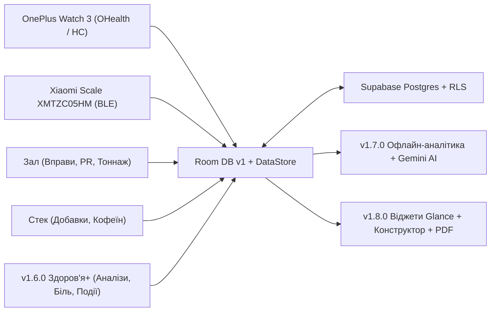

# Health Tracker — План розвитку (v1.6.0 → v1.8.0)

## 1. Поточний статус (`v1.5.1`)

На базі версії **v1.5.1** (`versionCode = 7`, перевірено на Samsung Galaxy S25 Ultra з 202 збереженими тренуваннями, 38/38 unit-тестів у 13 наборах) у додатку вже стабільно працюють:

- **Зал та прогресія:** логер тренувань (1 вправа на екран + свайп), PR / 1RM рушій, калькулятор млинців, Smart Hybrid Calories, 2D-анатомічна карта м'язів `BodyMap` та індекс м'язового відновлення (`MuscleRecoveryEngine`).
- **Годинник OnePlus Watch 3 (`OHealth` / Health Connect):** кроки, дистанція, активні калорії, не-силові кардіо-активності з дедуплікацією (`WatchActivityScreen`), підтягування пульсу та ккал до тренувань.
- **Ваги Xiaomi (`XMTZC05HM`):** фоновий BLE-перехоплювач навіть при закритому додатку (`XiaomiScaleCaptureService` + `ScaleScanWatchdogWorker`), сімейний фільтр ваги, аналітика 11 метрик складу тіла (`HealthScreen`).
- **Стек добавок:** персоналізований стек, матриця сумісності на 30+ добавок із пошуком (`SupplementInteractionEngine`), трекер піврозпаду кофеїну (`CaffeineHalfLifeEngine`, відбій `24:00`), пуш-нагадування з кнопкою `Прийнято ✓`, двостороння синхронізація передтрену із залом.
- **Хмара та код:** синхронізація з Supabase (`CloudSyncManager`, 21 таблиця з RLS) та репозиторій `Wildr23/HealthTracker`.

> [!IMPORTANT]
> **Ключова технічна перевага:** Усі Room-таблиці для етапів `v1.6.0` та `v1.7.0` (`daily_vitals`, `lab_reports`, `lab_markers`, `health_events`, `body_pain_logs`, `periodic_reports`) **вже створені** у `GymTrackerDatabase` (`version = 1`) та розгорнуті наживо в Supabase із RLS. Ба більше, дозволи Health Connect на `SleepSessionRecord`, `RestingHeartRateRecord`, `HeartRateVariabilityRmssdRecord`, `OxygenSaturationRecord` і `SkinTemperatureRecord` **вже оголошені** в `HealthConnectDataSource.requiredCorePermissions()`. Це означає **нуль міграцій БД** і **100% збереження історії** усіх 202 тренувань.

---

## 2. Архітектурна схема розвитку

---

## 3. Етап 1 — `v1.6.0`: Модуль «Здоров'я+»
*Фокус: вітальні тренди 30–90 днів з годинника, аналізи крові з подвійними нормами, журнал хвороб/травм та інтерактивна карта болю.*

### 3.1. Вітальні тренди з годинника (`daily_vitals`)
- **Дані та DAO (`Daos.kt`, `GymTrackerDatabase.kt`, `DatabaseModule.kt`):**
  - Додати `DailyVitalsDao` (CRUD, вибірка за `7 / 30 / 90` днів, upsert за `date`, трекінг `SyncState`).
- **Синхронізація Health Connect (`HealthDataSource.kt`, `HealthConnectDataSource.kt`, `VitalsRepository.kt`):**
  - Додати `readDailyVitalsHistory(daysBack)` для агрегації по днях: сон (`sleepMinutes`), ЧСС спокою (`restingHr`), варіабельність серцевого ритму (`hrvMs` через `HeartRateVariabilityRmssdRecord`), насичення киснем (`spo2Avg`), дельта температури шкіри (`wristTempDeltaC`), кроки та активні ккал.
- **Рушій готовності (`ReadinessEngine.kt` + `MuscleRecoveryEngine.kt`):**
  - Розрахунок ранкового індексу готовності (`0–100%`) відносно 14-денної персональної базової лінії користувача.
  - Раннє виявлення перевтоми або початку застуди (зростання RHR + падіння HRV + позитивна дельта температури зап'ястя).
  - Передача реальної історії сну/RHR у `MuscleRecoveryEngine.kt` замість оцінки лише за останньою добою.
- **UI (`HealthScreen.kt`):**
  - Нова вкладка / секція «Вітальні тренди» із перемикачем метрик (`Сон | RHR | HRV | SpO₂ | Темп.`) за діапазонами `7Д / 30Д / 90Д` та лінією 14-денної норми.

### 3.2. Трекер аналізів крові (`lab_reports`, `lab_markers`)
- **Дані та DAO (`Daos.kt`):**
  - Додати `LabDao` + реляційну модель `LabReportWithMarkers` (`LabReportEntity` + список `LabMarkerEntity`).
- **Каталог референсів (`LabReferenceCatalog.kt`):**
  - Готові пресети панелей для атлета:
    - *Гормони:* Тестостерон заг./вільний, ГСПГ, Естрадіол, Пролактин, ТТГ.
    - *Вітаміни й мінерали:* Вітамін D (25-OH), Феритин, B12, Магній, Цинк.
    - *Печінка / Нирки:* АЛТ, АСТ, Креатинін.
    - *Ліпідограма / Цукор:* ЛПНЩ, ЛПВЩ, Тригліцериди, Глюкоза, HbA1c.
    - *Загальний аналіз крові:* базові показники.
- **Функціонал (`LabsRepository.kt`, `LabsScreen.kt`, `Routes.LABS`):**
  - Створення звіту (дата, лабораторія, нотатки, прикріплення фото або PDF-бланка у `attachmentPath`).
  - Графіки динаміки по кожному маркеру з **подвійними смугами норми**: `Лабораторна норма` (`labRefMin..labRefMax`) та `Спортивний оптимум` (`athleteOptMin..athleteOptMax`).
  - Контекстні підказки зі `StackScreen`: якщо маркер (наприклад, Вітамін D, Феритин, Магній чи Цинк) нижче оптимуму — м'яка підказка перевірити/скоригувати стек, із чітким дисклеймером (інформація довідкова і не є медичною консультацією).

### 3.3. Журнал подій здоров'я та Карта болю (`health_events`, `body_pain_logs`)
- **Дані та репозиторій (`Daos.kt`, `HealthJournalRepository.kt`):**
  - Додати `HealthEventDao` та `BodyPainDao`.
  - Події (`HealthEventType`: `ILLNESS`, `INJURY`, `MEDICATION_COURSE`) із датами початку/завершення, тяжкістю `1–5`, симптомами та переліком ліків.
- **Інтерактивна карта болю (`BodyMap.kt`, UI у `HealthScreen.kt` або `HealthJournalScreen.kt`):**
  - Новий режим `PAIN` для `BodyMap` з тапом по 15 анатомічних зонах (`BodyZone`: `LEFT_SHOULDER`, `RIGHT_SHOULDER`, `LOWER_BACK`, `UPPER_BACK`, `LEFT_KNEE`, `RIGHT_KNEE`, `LEFT_ELBOW`, `RIGHT_ELBOW`, `LEFT_WRIST`, `RIGHT_WRIST`, `NECK`, `LEFT_HIP`, `RIGHT_HIP`, `CHEST`, `ABS`), фіксацією болю `1–10` та нотаткою.
- **Інтеграція із залом (`MuscleRecoveryScreen.kt`, `ActiveWorkoutScreen.kt`):**
  - Активний біль (`≥4/10` за останні 72 год) або незакрита подія `INJURY` автоматично підсвічує відповідну зону та показує м'яке попередження на картці релевантної вправи під час тренування.

### 3.4. Cloud Sync та Unit-тести (`v1.6.0`)
- **`CloudSyncManager.kt`:** додати upload/restore для `daily_vitals`, `lab_reports`, `lab_markers`, `health_events`, `body_pain_logs`.
- **Тести:** `ReadinessEngineTest`, `LabReferenceCatalogTest`, розширення `MuscleRecoveryEngineTest`.

---

## 4. Етап 2 — `v1.7.0`: Модуль «Інсайти + AI-тренер (Gemini)» та Періодичні звіти
*Фокус: заміна заглушки Milestone 3 в `InsightsScreen.kt` на потужну офлайн-аналітику та опціонального AI-тренера.*

### 4.1. Офлайн-аналітика (100% без інтернету й без API-ключа)
- **`TrainingInsightsEngine.kt`:**
  - **Об'єм проти цільових орієнтирів:** тижневі та місячні робочі сети по м'язових групах у порівнянні з `MEV / MAV / MRV`.
  - **Детектор прогресії та плато:** виявляє вправи, де `e1RM` стабільно росте, і вправи зі стагнацією `≥3` сесій поспіль.
  - **Міжмодульні кореляції:**
    - `Сон / RHR ↔ Тоннаж та середній пульс тренування`.
    - `Предтрен / Кофеїн ↔ Продуктивність у залі та якість сну`.
    - `Склад тіла Xiaomi ↔ Відносна сила (e1RM / маса тіла)`.
- **UI (`InsightsScreen.kt`, `InsightsViewModel.kt`):**
  - Повноцінні картки аналітики, графіки об'єму, список плато та кореляційні інсайти замість поточної заглушки.

### 4.2. Gemini AI-тренер та Періодичні звіти (`periodic_reports`)
- **Дані (`Daos.kt`, `AiCoachRepository.kt`):**
  - Додати `PeriodicReportDao` для `PeriodicReportEntity` (`WEEKLY` / `MONTHLY`, `metricsJson`, `aiSummaryMarkdown`, `actionItemsJson`) із синхронізацією в Supabase.
- **Варіанти підключення API (на вибір користувача):**
  - **Варіант A (BYOK):** користувач вводить власний Gemini API Key у Налаштуваннях (ключ зберігається локально зашифровано).
  - **Варіант B (Supabase Edge Function):** ключ зберігається у секретах проєкту Supabase, а Android-додаток викликає захищену функцію з JWT-авторизацією.
- **3 практичні AI-сценарії:**
  1. **Тижневий / Місячний холістичний звіт:** зводить дані Залу + Годинника + Ваг Xiaomi + Стеку + Аналізів у структурований Markdown-звіт + конкретні `actionItems` на наступний тиждень.
  2. **Передтренувальний брифінг:** підказує цільову вагу/повторення або режим deload з урахуванням відновлення м'язів, сну, RHR та актуальних записів болю.
  3. **AI-парсер бланків аналізів (Gemini Vision):** розпізнає фото/PDF-бланк аналізу крові й формує чернетку `LabReportEntity` з обов'язковим підтвердженням користувача перед збереженням.

### 4.3. Unit-тести (`v1.7.0`)
- **`TrainingInsightsEngineTest`:** перевірка розрахунків `MEV / MAV / MRV`, виявлення плато та кореляцій.
- **`AiPayloadBuilderTest`:** перевірка контракту формування JSON-пейлоаду та гарантованої відсутності чутливих персональних ідентифікаторів (PII).

---

## 5. Етап 3 — `v1.8.0`: Автоматизація, Конструктор програм, Віджети та CI/CD
*Фокус: повна автономність щоденного використання, редагування сплітів у додатку, віджети на головний екран та автоматизація збірки.*

- **5.1. Подієва інкрементальна авто-синхронізація Supabase:**
  - Автоматичний debounced `WorkManager` upload лише змінених рядків (`SyncState.PENDING_UPLOAD`) після завершення тренування, фонового зважування Xiaomi, логів Стеку чи аналізів — на додачу до щоденного 24h heartbeat `CloudSyncWorker`.
- **5.2. Конструктор програм тренувань і кастомних вправ:**
  - Повноцінне створення, редагування та зміна порядку програм, днів, вправ, суперсетів і додавання власних вправ із мапінгом цільових м'язів без потреби імпортувати CSV із Jefit.
- **5.3. Домашні віджети Android (Jetpack Glance):**
  - *«Стек сьогодні»:* список активних слотів із 1-тап відміткою прийому.
  - *«Готовність і Годинник»:* кроки, сон, % відновлення, залишок кофеїну на поточну годину.
  - *«Вага і % жиру»:* останній замір Xiaomi та дельта за 30 днів.
- **5.4. Експорт для лікаря/тренера, Release Signing та GitHub Actions CI:**
  - Генерація зведеного PDF / Markdown-звіту за `30–90` днів (аналізи + вітальні + склад тіла + навантаження).
  - Workflow `.github/workflows/android-ci.yml` для автоматичного запуску `testDebugUnitTest` на кожен push / PR.
  - Конфігурація підписаного `release` APK (локальний keystore у `.gitignore`).

---

## 6. Зведена таблиця пріоритетів

| Реліз | Фокус | Складність | Цінність для користувача | Ключові залежності |
| :--- | :--- | :--- | :--- | :--- |
| **v1.6.0** | **Здоров'я+:** вітальні тренди, аналізи крові, журнал подій та карта болю | Середня | Висока (замикає цикл здоров'я й біометрії) | Наявні Room-таблиці `v1`, Health Connect, `BodyMap` |
| **v1.7.0** | **Інсайти + Gemini AI:** офлайн-аналітика, AI-брифінги, звіти й OCR аналізів | Середня / Висока | Дуже висока (персоналізовані рішення щодня) | Дані Залу/Стеку + бажано вітальні/аналізи з `v1.6.0` |
| **v1.8.0** | **Автоматизація та QoL:** інкрементальний sync, конструктор програм, віджети, CI | Середня | Висока (зручність щодня, незалежність від Jefit) | Стабільне ядро `v1.5.1–v1.7.0` |

---

## 7. Незмінні правила безпеки даних і план верифікації

1. **Захист історії тренувань:** `GymTrackerDatabase` залишається на `version = 1`, `applicationId = "com.gymtracker.app"` не змінюється — усі 202 тренування зберігаються при будь-якому оновленні `adb install -r`.
2. **Гігієна репозиторію:** у Git ніколи не потрапляють `local.properties`, `*.csv`, `Screenshots/`, `*.apk`, `*.jks` / `*.keystore` та секрети API.
3. **Обов'язкова перевірка перед кожним релізом:**
   - Повний прогін unit-тестів і збірки: `.\gradlew.bat testDebugUnitTest assembleDebug`
   - Оновлення поверх установленої версії на Samsung Galaxy S25 Ultra (`adb install -r`) + ручне QA ключових сценаріїв.

---

## 8. Відкриті питання для узгодження

1. **З якого етапу стартуємо першим?** Робимо послідовно **v1.6.0 «Здоров'я+»** (вітальні тренди + аналізи крові + карта болю), чи хочеш одразу почати з **v1.7.0 «Інсайти + AI-тренер»** (або скомбінувати конкретні фічі)?
2. **Як підключаємо Gemini AI-тренера?** Вводитимеш власний безкоштовний Gemini API Key у Налаштуваннях (BYOK — найпростіше і без серверної інфраструктури) чи підіймаємо серверну проксі-функцію через Supabase Edge Function?
3. **Чи потрібно додавати `ROADMAP.md` у GitHub-репозиторій (`Wildr23/HealthTracker`),** чи тримати його лише локально в робочій папці?
